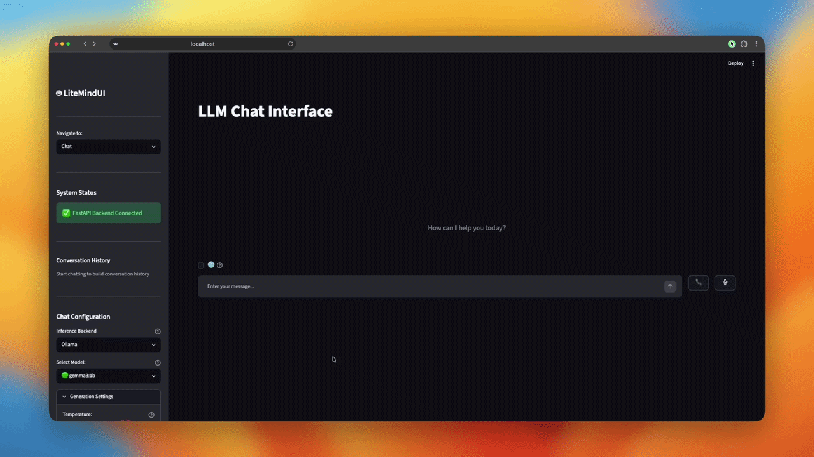

# LiteMindUI

LiteMindUI is a local-first AI workspace with a FastAPI backend and a production-grade **Next.js / TypeScript** frontend for chat, RAG, web search, and voice-enabled workflows. It supports Ollama for local models plus OpenRouter and Nvidia NIM for LiteLLM-hosted models.



## Quick start

| Mode | Best for | Command |
| --- | --- | --- |
| Quick install | Fastest path with prebuilt Docker images | `curl -fsSL https://raw.githubusercontent.com/debabratamishra/litemind-ui/main/install.sh \| bash` |
| Docker from source | Running the repo locally with the checked-out source | `make up` |
| Native install | Development on the Python + Node.js codebase | `uv sync --group all && npm --prefix nextjs-frontend install` |

### 1. Quick install with prebuilt Docker images

```bash
curl -fsSL https://raw.githubusercontent.com/debabratamishra/litemind-ui/main/install.sh | bash
```

This downloads `infra/docker/compose/docker-compose.hub.yml`, prepares the required runtime directories, and starts the app with prebuilt images.

### 2. Run from source with Docker

```bash
git clone https://github.com/debabratamishra/litemind-ui.git
cd litemind-ui
make up
```

Useful variants:

- `make dev` - development compose stack
- `make prod` - production-style compose stack
- `make hub-up` - pull and run Docker Hub images from this repo

### 3. Run natively for development

```bash
git clone https://github.com/debabratamishra/litemind-ui.git
cd litemind-ui
uv sync --group all
mkdir -p uploads
```

If you want to override defaults, copy `.env.example` to `.env` before starting the services.

**Backend:**

```bash
uv run uvicorn backend.main:app --host 0.0.0.0 --port 8000
```

**Frontend (Next.js):**

```bash
cd nextjs-frontend
npm install
npm run dev       # development server at http://localhost:3000
# or
npm run build && npm start   # production server
```

## Default URLs

| Surface | URL |
| --- | --- |
| **Next.js frontend** | `http://localhost:3000` |
| FastAPI backend | `http://localhost:8000` |
| API docs | `http://localhost:8000/docs` |
| Health check | `http://localhost:8000/health` |

## Features

- **Streaming responses** — SSE for chat, plain-text streams for RAG and web search
- **Generative UI** — AI responses can embed charts (bar/line/pie), tables, metrics, progress bars, and interactive buttons using fenced `ui:*` blocks
- **Voice input** — Web Speech API microphone capture with live transcription, auto-submits on recognition
- **Markdown rendering** — syntax-highlighted code blocks, GFM tables, and more via `react-markdown`
- **RAG / Knowledge Base** — drag-and-drop file upload, duplicate detection, multi-agent and hybrid search options
- **Web Search** — SerpAPI-grounded responses with inline streaming results
- **Persistent personalization** — LiteMindUI remembers durable facts you share (preferences, projects, corrections) across sessions and providers, injects them into new chat/RAG/voice conversations (multi-agent RAG mode excluded), and lets you manage them in Settings → Memory.
- **Settings page** — model catalogue (local + cloud), backend configuration (Ollama, OpenRouter, Nvidia NIM), generation parameter tuning

## Repository layout

```text
backend/              canonical FastAPI backend package
  main.py             backend entrypoint
  config.py           global configuration
  logging_config.py   structured logging
  app/                backend application modules
nextjs-frontend/      Next.js / TypeScript production frontend
  src/                App Router pages and shared UI modules
infra/docker/         Dockerfiles and Compose workflow definitions
docs/                 documentation, design records, and the Astro site
scripts/              setup, Docker, release, and health-check helpers
tests/                Python test suite
main.py               compatibility shim for backend.main
config.py             compatibility shim for backend.config
logging_config.py     compatibility shim for backend.logging_config
```

## Documentation

- [`docs/README.md`](docs/README.md) - documentation index
- [`docs/api-contract.md`](docs/api-contract.md) - full backend API contract (used by the Next.js client)
- [`DOCKER.md`](DOCKER.md) - Docker guide shortcut
- [`docs/docker/README.md`](docs/docker/README.md) - Docker workflows, health checks, and compose files
- [`docs/docker/publishing.md`](docs/docker/publishing.md) - image publishing and release automation

## Testing

### Backend tests (Python/pytest)

```bash
# Run all tests with coverage
uv run pytest

# Run with verbose output
uv run pytest -v

# Run specific test file
uv run pytest tests/test_rag_skills.py

# Run with coverage report
uv run pytest --cov=backend --cov-report=term-missing

# Run with HTML coverage report
uv run pytest --cov=backend --cov-report=html
# Open htmlcov/index.html in a browser to view coverage
```

### Frontend tests (React/Vitest)

```bash
cd nextjs-frontend
npm run test
```